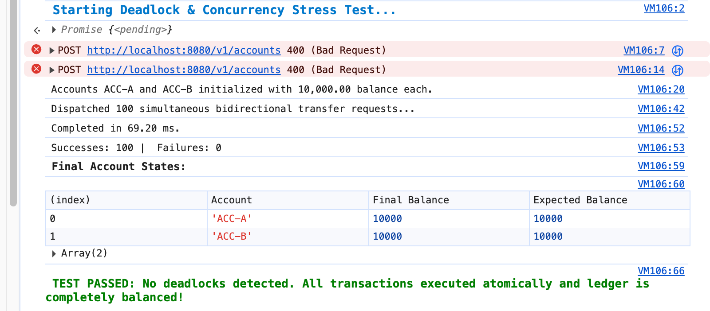

# Bank Transfer Service — Engineering Architecture & Implementation

A robust, thread-safe financial transfer REST API built with **Java 17** and **Spring Boot 3.4.0**, designed to process concurrent account balance transfers with absolute transactional integrity, zero deadlocks, and strict domain validation.

---

## 1. System Overview

This service provides atomic financial operations across bank accounts stored in an in-memory repository. The system is engineered to solve core concurrent banking challenges:

- **Deadlock-Free Execution**: Uses deterministic natural locking order (`accountId.compareTo(...)`) across competing transactions.
- **Data Integrity & Consistency**: Enforces atomic balance updates via instance-level `ReentrantLock` guards and exact decimal math via `BigDecimal`.
- **Zero-Overdraft Enforcement**: Prevents accounts from falling below zero balance.
- **Dual Notification Delivery**: Dispatches notifications to both debited and credited account holders using `NotificationService`.
- **Comprehensive API Documentation & Observability**: Interactive OpenAPI 3 / Swagger documentation and health/metric monitoring via Spring Boot Actuator.

---

## 2. API Specifications & Interactive Swagger Documentation

Interactive API documentation and schema exploration are exposed via SpringDoc OpenAPI.

| Resource | URL | Description |
| :--- | :--- | :--- |
| **Swagger UI** | [http://localhost:8080/swagger-ui.html](http://localhost:8080/swagger-ui.html) | Interactive web interface to test endpoints and inspect schemas |
| **OpenAPI Specification** | [http://localhost:8080/api-docs](http://localhost:8080/api-docs) | Raw OpenAPI 3.0 JSON specification file |

### Available Endpoints

#### 1. Register Account
- **HTTP Method:** `POST /v1/accounts`
- **Request Body:**
  ```json
  {
    "accountId": "Id-101",
    "balance": 1500.00
  }
  ```
- **Responses:**
    - `201 Created`: Account registered successfully.
    - `400 Bad Request`: Validation failure (blank account ID, negative initial balance, or duplicate account ID).

#### 2. Retrieve Account by ID
- **HTTP Method:** `GET /v1/accounts/{accountId}`
- **Responses:**
    - `200 OK`: Returns account payload (`{"accountId": "Id-101", "balance": 1500.00}`).
    - `404 Not Found`: Account does not exist.

#### 3. Execute Transfer
- **HTTP Method:** `POST /v1/accounts/transfer`
- **Request Body:**
  ```json
  {
    "accountFromId": "Id-101",
    "accountToId": "Id-202",
    "amount": 250.00
  }
  ```
- **Responses:**
    - `200 OK`: Transfer completed successfully.
    - `400 Bad Request`: Insufficient funds, zero or negative transfer amount, missing body, or self-transfer.
    - `404 Not Found`: Debit or credit account does not exist.

---

## 3. Observability & Operational Monitoring

Observability is integrated via **Spring Boot Actuator** to provide runtime health visibility and operational metrics:

| Endpoint | URL | Purpose |
| :--- | :--- | :--- |
| **Health Check** | [http://localhost:8080/actuator/health](http://localhost:8080/actuator/health) | Liveness and readiness inspection for container orchestration |
| **Application Metrics** | [http://localhost:8080/actuator/metrics](http://localhost:8080/actuator/metrics) | Detailed JVM, HTTP, and CPU usage telemetry |
| **Transfer Specific Metrics** | `http://localhost:8080/actuator/metrics/http.server.requests` | Latency (p50/p95/p99) and invocation counts for `/v1/accounts/transfer` |

### Key Observability Features
- **Health Indicators**: Real-time status reporting ready for Kubernetes liveness/readiness probes.
- **Metrics Scraping Support**: Native compatibility with Prometheus, Datadog, and Micrometer exporters for dashboard visualization.
- **Structured Error Reporting**: Standardized error responses across all endpoints returning timestamped, descriptive JSON envelopes:
  ```json
  {
    "timestamp": "2026-10-12T14:30:00",
    "status": 400,
    "error": "Bad Request",
    "message": "Account Id-101 has insufficient funds (Current: 100.00, Requested: 250.00)."
  }
  ```

---

## 4. Key Features Implemented

### Thread-Safe Concurrency & Deadlock Prevention
- **Deterministic Lock Ordering**: Prevents circular-wait deadlocks during simultaneous cross-transfers (e.g., Thread 1 transferring $A \to B$ while Thread 2 transfers $B \to A$). Locks are acquired in lexicographical order based on `accountId`.
- **Granular Account Locks**: Each `Account` manages its own `ReentrantLock`. Transfers between accounts $A$ and $B$ do not block unrelated transfers between accounts $C$ and $D$.
- **Precision Accounting**: Uses `BigDecimal` for all monetary arithmetic to prevent IEEE 754 floating-point inaccuracies.

### Defensive Domain Validation
- **No Overdrafts**: Transfers strictly fail if the debit account does not hold sufficient cleared funds.
- **Positive-Only Transfers**: Amounts must be strictly positive ($> 0$).
- **Distinct Account Verification**: Rejects transfers where source and destination IDs are identical (`accountFrom == accountTo`).
- **Account Existence Verification**: Confirms both accounts exist prior to locking or balance mutation.

### Dual-Party Notifications
- Dispatches transactional notifications to **both** sender and receiver through the `NotificationService` boundary:
    - Sender receives confirmation of debit with target account details.
    - Receiver receives confirmation of credit with source account details.
- **Non-Blocking Fault Isolation**: Notification dispatch occurs strictly after locks are released and balance changes are committed. Notification transport hiccups do not stall the core transfer ledger or roll back a cleared transaction.

---

## 5. Enterprise Production Readiness & Future Scope

While the reference implementation fulfills all challenge requirements using an in-memory repository within a single JVM, transitioning this service to an enterprise-grade banking environment requires the following architectural enhancements:

### 1. Asynchronous Messaging & Microservices Decoupling
- **Transactional Outbox Pattern**: Replace synchronous notification dispatch with an append-only outbox table. Balance mutations and outbox records commit in the same local database transaction.
- **Event Streaming via Apache Kafka / RabbitMQ**: A log-tailing Change Data Capture (CDC) agent (e.g., Debezium) streams outbox events to Kafka topics, feeding an independent Notification Microservice for SMS, email, and push deliveries without holding transfer locks.
- **Resilient Inter-Service Calls**: Introduce Spring Cloud OpenFeign paired with **Resilience4j** circuit breakers, retries, and rate limiters for external downstream integrations.

### 2. Distributed Persistence & Distributed Locking
- **Stateless Application Tier**: Move account balances from JVM memory to an enterprise RDBMS (PostgreSQL, Oracle) managed via Spring Data JPA.
- **Database Row-Level Locking**: Replace in-memory `ReentrantLock` instances with database-level pessimistic locking (`SELECT ... FOR UPDATE` ordered by `account_id`) to ensure serializability across multi-instance, auto-scaled container pods.
- **Distributed Saga Pattern**: For accounts spanning separate database shards, replace blocking Two-Phase Commit (2PC) with an orchestrated Saga pattern using compensating transactions.

### 3. Edge Routing, Security & Idempotency
- **API Gateway (Spring Cloud Gateway)**: Centralize TLS termination, CORS policy management, request routing, and rate limiting (Token Bucket via Redis).
- **OAuth2 / OIDC Security**: Protect endpoints with Spring Security configured as a JWT Resource Server, validating tokens from providers like Okta, Keycloak, or Azure AD with role-based access control (`SCOPE_transfers:write`).
- **Two-Tier Idempotency**:
    - *Edge Layer*: Validate an `Idempotency-Key` HTTP header cached in Redis (`SETNX`) to discard duplicate retries instantly.
    - *Database Layer*: Persist processed idempotency keys with an ACID `UNIQUE` constraint to protect ledger integrity against race conditions or cache flushes.

### 4. Advanced Observability & Distributed Tracing
- **Distributed Tracing (OpenTelemetry / Micrometer Tracing)**: Inject and propagate `traceId` and `spanId` context through incoming HTTP headers, logging MDC, and Kafka message records.
- **Centralized Logging (Splunk / ELK Stack)**: Output structured JSON logs (`LogstashLogbackEncoder`) for log ingestion, security monitoring, and regulatory compliance.
- **Prometheus & Grafana Dashboards**: Set up alerting on transfer latency percentiles (p95, p99), error rates (HTTP 4xx/5xx), and database connection pool saturation.

### 5. Automated CI/CD, Containerization & Audit Logging
- **Containerization**: Build multi-stage, rootless Docker images based on minimal container base images (e.g., Eclipse Temurin Alpine/Distroless).
- **Automated CI/CD Pipelines**: Run automated static code analysis (SonarQube), container security vulnerability scanning (Trivy), unit tests, and multi-threaded stress tests before staging deployment.
- **Immutable Double-Entry Ledger**: Maintain an append-only audit log table (`transfer_audit_log`) capturing immutable snapshots of pre- and post-transfer balances, timestamps, operator IDs, and correlation keys for regulatory compliance.

---

## 6. Build and Run Instructions

### Prerequisites
- Java 17
- Gradle (or included `./gradlew` wrapper)

### Build and Run Application
```bash
# Build the project
./gradlew clean build

# Run the application
./gradlew bootRun
```

The application starts on `http://localhost:8080`.

### Run Test Suite
```bash
./gradlew test
```
---
Deadlock Test
